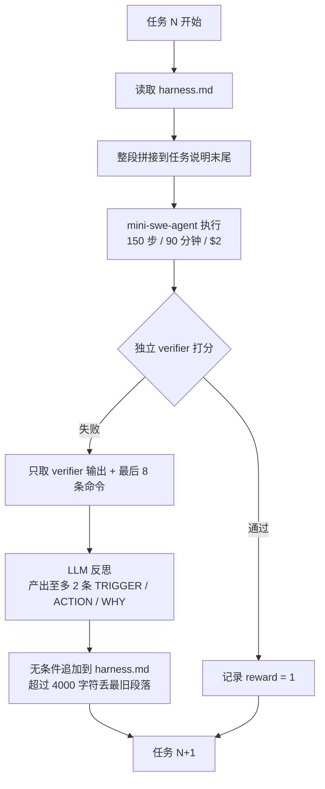
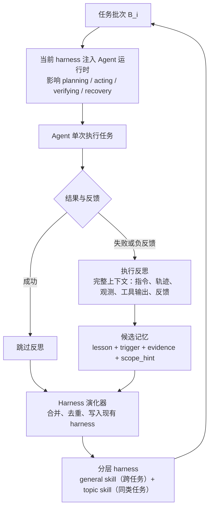

# 反思：我们做的和论文做的差在哪

这份文档回答三个问题：TB2 和 TB4 到底在测什么不同的东西、我们的实现与 Evo-Harness 论文的流程差在哪、以及这个仓库目前能证明什么。

结论先放：**这一版不是论文的复现，是论文最小骨架的一次实现**。差别不在参数，在三个结构性的组件上。

## 1. Benchmark 层面：TB2 和 TB4 不是同一件事

| | TB 2.0 | TB 4.0 |
|---|---|---|
| 任务数 | 89 | 66 |
| Agent 超时 | 10–30 分钟 | 统一 **8 小时** |
| 验证方式 | 任务镜像内跑测试 | **独立 verifier 容器**，独立镜像 |
| 声明资源 | 1–2 核 / 2–4 GiB | 2–16 核 / 4–32 GiB |
| 镜像总量 | 45.6 GiB | 86.3 GiB |
| 专家耗时中位数 | 5–60 分钟 | **4 小时**（最长 60 小时） |
| 前沿模型通过率 | ~83%（2.1 版） | ~60% |
| DeepSeek Flash | ~83%（厂商口径） | 34–42% |

两套题侧重点不同：TB2 更偏"短任务里会不会正确使用工具"，TB4 把验证器隔离、时间放宽到 8 小时，测的是"长程任务里能不能自己推进、自己验证"。**分数不可跨版本比较。**

论文在 TerminalBench2 上验证 Evo-Harness。这意味着它的失败分布里有更多"流程走不对"的成分——这正是反思能提炼出可复用操作序列的场景。我们换到 TB4 以后，失败更多是"这个任务独有的 bug 没找到"，反思自然只能产出实例级诊断。**这是方法假设与任务特性的错配，不是实现 bug。**

## 2. 两条流程

### 我们跑的版本

关键特征：**反馈窄、结构松、注入粗、无验收**。

### 论文的版本

关键特征：**反馈完整、结构显式、分域存储、有合并策略**。

## 3. 逐项差异

| 环节 | 我们的实现 | 论文 | 造成什么后果 |
|---|---|---|---|
| 反思输入 | verifier 输出 + 最后 8 条命令 | 完整执行上下文（指令、轨迹、观测、工具输出、反馈） | 只能看到"结果错在哪"，看不到"过程为什么错" |
| 记忆结构 | 自由文本 | `lesson / trigger / evidence / scope_hint` 四元组 | 没有 scope 就无法判断适用范围 |
| 分域 | 无 | general skill + topic skill 两层 | 跨域污染：HTML 经验注入到 WAL 恢复题 |
| 注入位置 | 任务说明末尾 | Agent 运行时（规划、执行、验证、恢复） | 建议被当成额外需求，与任务要求冲突 |
| 注入粒度 | 整个 harness 全量 | 按 scope 检索相关内容 | 无关条目占用上下文、误导工具选择 |
| 合并策略 | 无条件追加 | 演化器合并去重 | 重复经验堆积，有效经验被挤掉 |
| 淘汰策略 | 超过 4000 字符丢最旧 | 由 harness 结构决定 | 同一题在不同时刻看到不同版本，处理不一致 |
| 验收门槛 | 无 | 通过实验分析哪些更新真正有效 | 错误经验无法被拦截 |
| 评估协议 | 每题 1 次、15 题、单一顺序 | 五个 benchmark、顺序任务流 | 单次方差就能翻转结果，效应无法与噪声分离 |

## 4. 三个最关键的缺口

**缺 scope。** 最根本的一条。没有"这条经验属于哪类任务"的标注，选择性注入就不可能实现，而选择性注入正是"迁移"和"干扰"的分界线。

**缺验收。** 论文把 harness 更新当作需要验证的假设；我们是"失败就写进去"。没有验收门槛，harness 只会单调增长，质量不可避免地下降。

**缺可分离的评估。** 每题只跑一次，`html-js-filter` 在 harness 为空时也翻转了——说明单次结果里有相当比例是噪声。在这种信噪比下，任何小于 20 个点的效应都测不出来。

## 5. 这个仓库现在能证明什么

不能说"复现了 Evo-Harness"。能说的是：

1. **能搭起可复现的评测管线**：Harbor + mini-swe-agent + TB4，固定预算、逐题记录 token/费用/耗时，附带 provenance（版本、镜像、任务文件哈希、job ID）。
2. **能跑出干净基线**：19 题逐题标注有效 / 截断 / 无效，而不是把截断当失败。
3. **能实现一个方法骨架并诚实报告负结果**：14 组配对，10 → 6，翻盘 0、退步 4。
4. **能定位失败原因**：四层机制问题 + 两个实验设计问题，并对齐到论文的具体组件。

第 4 点通常比第 2 点更难，也更少见于学生项目。

## 6. 如果继续做

按优先级，前两步各几十行改动：

1. **scope 字段 + 按 category 过滤注入**（把"迁移"和"干扰"分开）
2. **注入改到 system prompt**（从"要求"变回"背景"）
3. **去重 + 按 scope 分桶淘汰**，替掉"丢最旧"
4. **加验收门槛**：新经验先在 1–2 道留出题上验证有效再写入（GEPA 的 minibatch 接受思路）
5. **每题 3 次重复**，配对比较，把效应和方差分开

做完 1–2 之后重跑同一组 15 题，才有资格讨论"Evo-Harness 在 TB4 上行不行"。现在只能说：**这一版实现无效，且原因已经定位。**
